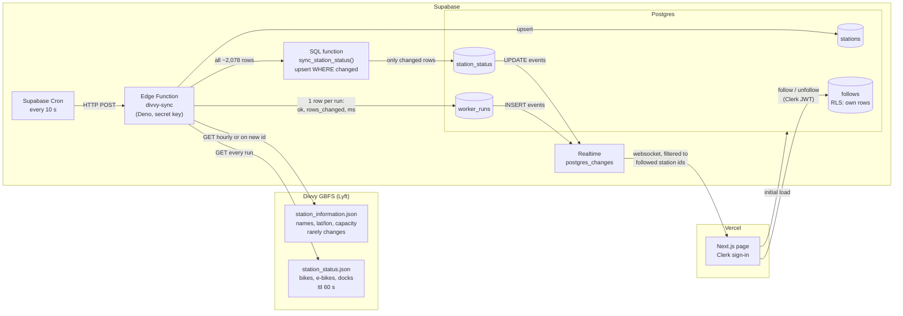

# Data flow

Drawn before any code was written. GitHub renders the chart below.

## What each part sends to the next

| from → to | sends | if it changed |
|---|---|---|
| Divvy → worker | JSON `{last_updated, ttl, data: {stations: [...]}}` | A renamed field (e.g. GBFS v3 `num_vehicles_available`) parses as `undefined`. The worker validates and records a failed run instead of writing nulls. |
| Cron → worker | an HTTP POST every 10 s | If Cron stops, no new runs appear. The page sees the last run getting old and shows **stale**. |
| worker → `sync_station_status` | every station's numbers | If the worker sent `last_reported` as a compared field, ~7x more rows would "change". |
| SQL → `station_status` | only rows whose bikes / e-bikes / docks / in-service changed | This is what keeps Realtime and egress inside the free tier. |
| worker → `worker_runs` | `ran_at, ok, rows_changed, duration_ms, error, feed_updated_at` | The page's fresh / stale / down states all read this table. |
| Realtime → page | one message per changed row, only for stations the person follows | Realtime silently sends nothing if the table isn't in the publication, the role lacks `select`, or RLS blocks it. |
| page → `follows` | `{station_id}`, `user_id` from the Clerk JWT `sub` | RLS ensures you only see and change your own follows. |

## Page states

| state | rule |
|---|---|
| loading | first fetch or Realtime subscribe hasn't finished |
| fresh | last run ok and < 60 s ago |
| stale | newest successful run is >= 60 s old (6 missed runs) |
| down | the most recent run failed |

## Free-tier budget

- Edge Function calls: every 10 s = ~259k / month of 500k.
- Realtime: only changed, followed rows reach a page, plus one `worker_runs` insert per run.
- `worker_runs` grows by 8,640 rows a day, so a daily Cron job deletes runs older than 24 h.
